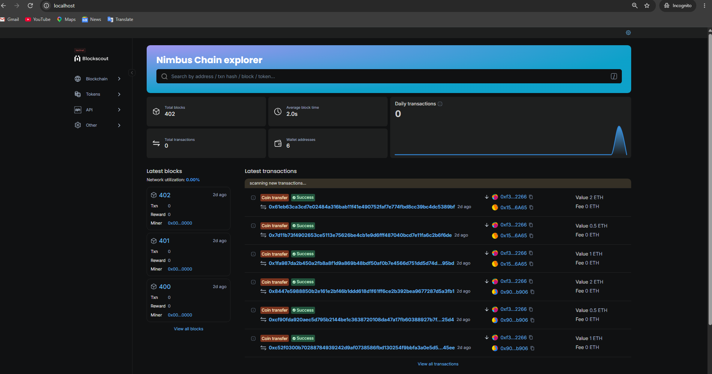
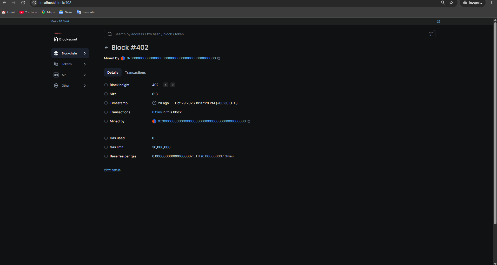
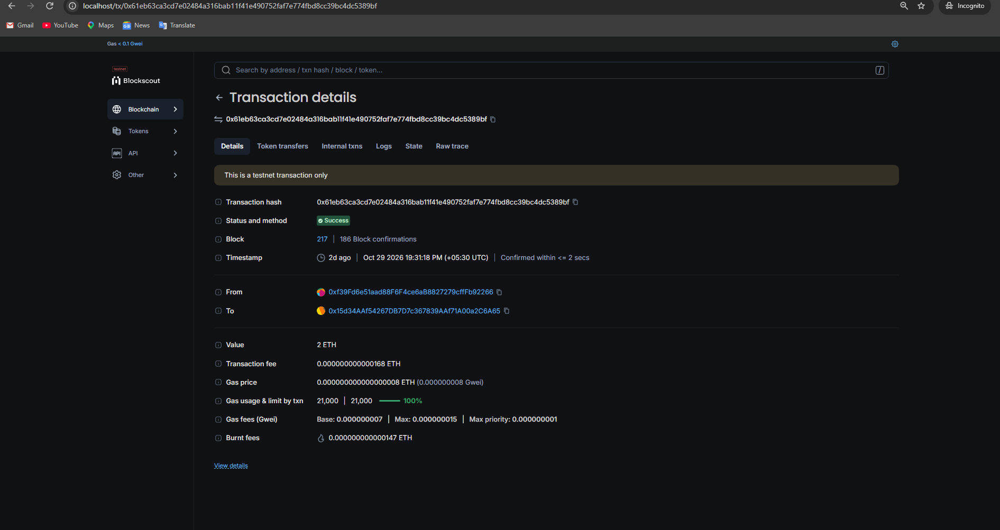

# Blockscout Block Explorer on Docker

A self-hosted block explorer for any EVM chain, built with Blockscout, PostgreSQL, Redis and Caddy, running through Docker Compose.

## Screenshots

| Home | Block | Transaction |
|------|-------|-------------|
|  |  |  |

*Screenshots taken on a local test network.*

## Stack

| Layer | Tech |
|-------|------|
| Indexer + API | Blockscout 6.10.1 |
| Frontend | Blockscout frontend (Next.js) |
| Reverse proxy | Caddy |
| Database / cache | PostgreSQL 15, Redis |

```
Browser -> Caddy -> Frontend / Backend API -> PostgreSQL, Redis -> EVM RPC node
```

## Quick start

```bash
cp .env.example .env      # fill in your values
docker compose up -d
```

Open http://localhost and allow a few minutes to initialize.

You need a running EVM node to index. To try it without your own chain, use the local test chain below.

## Test with a local chain (Foundry)

I used Anvil from [Foundry](https://book.getfoundry.sh/) as a local test chain.

1. Start a local chain:
   ```bash
   docker run --rm -p 8545:8545 --entrypoint anvil \
     ghcr.io/foundry-rs/foundry:latest \
     --host 0.0.0.0 --chain-id 31337 --block-time 2
   ```
2. Keep the default values in `.env.example` (`RPC_URL=http://host.docker.internal:8545`, `CHAIN_ID=31337`) and set your own `POSTGRES_PASSWORD` and `SECRET_KEY_BASE`.
3. Start the explorer:
   ```bash
   docker compose up -d
   ```
4. Send a test transaction:
   ```bash
   docker run --rm --entrypoint cast ghcr.io/foundry-rs/foundry:latest \
     send --unlocked --from 0xf39Fd6e51aad88F6F4ce6aB8827279cffFb92266 \
     0x70997970C51812dc3A010C7d01b50e0d17dc79C8 --value 1ether \
     --rpc-url http://host.docker.internal:8545
   ```

### Other local test chains

**Hardhat:**
```bash
npx hardhat node
```
Use the same values as Anvil (`geth`, `31337`).

## Connect your own chain

1. Get your chain's JSON-RPC URL.
2. Find the chain ID:
   ```bash
   curl -s -X POST <RPC_URL> -H 'Content-Type: application/json' \
     --data '{"jsonrpc":"2.0","method":"eth_chainId","params":[],"id":1}'
   ```
   The result is hex. Convert it to decimal (`0x7a69` = `31337`).
3. Edit `.env` using the tables below, then run:
   ```bash
   docker compose down -v && docker compose up -d
   ```

### Settings

| Variable | Meaning |
|----------|---------|
| `RPC_URL` | JSON-RPC endpoint of the chain to index |
| `RPC_VARIANT` | Node type (see table below) |
| `CHAIN_ID` | Chain ID of the network |
| `NETWORK_NAME` | Name shown in the explorer |
| `CURRENCY_SYMBOL` | Native token symbol |
| `IS_TESTNET` | `true` for a testnet, `false` for mainnet |
| `DISABLE_INTERNAL_TXS` | `true` if your RPC does not support tracing |
| `POSTGRES_PASSWORD` | Your own database password |
| `SECRET_KEY_BASE` | Generate with `openssl rand -base64 48` |

### Settings by node type

| Your chain | `RPC_URL` | `RPC_VARIANT` | `CHAIN_ID` |
|---|---|---|---|
| Foundry Anvil (local) | `http://host.docker.internal:8545` | `geth` | `31337` |
| Hardhat node (local) | `http://host.docker.internal:8545` | `geth` | `31337` |
| Ganache (local) | `http://host.docker.internal:8545` | `ganache` | `1337` |
| Public testnet / hosted RPC | `https://<provider-rpc-url>` | `geth` | the network's chain ID |
| Self-hosted Geth node | `http://<node-host>:8545` | `geth` | your chain ID |
| Erigon / Nethermind / Besu node | `http://<node-host>:8545` | `erigon` / `nethermind` / `besu` | your chain ID |
| Avalanche L1 (Subnet-EVM) | `https://<host>/ext/bc/<BLOCKCHAIN_ID>/rpc` | `geth` | your EVM chain ID |

Only the Anvil setup was tested for this project. The other rows follow Blockscout's supported node variants.

### Notes

- **Local nodes:** inside Docker, `localhost` means the container itself. Use `host.docker.internal` to reach a node running on your machine.
- **Node in another container:** put both on the same Docker network and use the container name, for example `http://my-node:8545`.
- **Internal transactions:** these need a node that supports tracing (`debug_traceTransaction`). If your RPC does not, set `DISABLE_INTERNAL_TXS=true`.

## Use a domain with HTTPS

Replace `http://localhost` in the `Caddyfile` with your domain, and update the `*_HOST` and `*_PROTOCOL` values in `compose.yml` (`http` to `https`, `ws` to `wss`). Caddy gets the certificate automatically.

## Note

Generic reference deployment. No proprietary configuration is included.